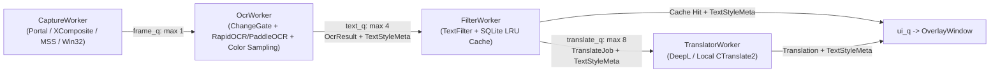

# 🏗️ GameOCR Architecture & Data Pipeline

GameOCR is designed around a multi-threaded producer-consumer pipeline so that the Qt user interface (`MainThread`) never freezes while capturing frames, sampling text colors, running GPU OCR, or translating subtitles.

---

## 1. Multi-Threaded Pipeline Overview

### 1.1. `CaptureWorker`
- Captures the target window or screen region at the configured `fps` (default `8.0`).
- Uses `_put_drop_oldest` on `frame_q` (`maxsize=1`) so `OcrWorker` always processes the freshest frame without building up latency.
- Handles `ControlKind.RESELECT_WINDOW` live without restarting the application.

### 1.2. `OcrWorker` & Dynamic Visual Text Alignment (`TextStyleMeta`)
- Evaluates pixel delta via `ChangeGate`. If the subtitle region hasn't changed, OCR is skipped to save GPU/CPU cycles.
- When text is detected, `OcrEngine.recognize_with_meta(processed, raw_img=cropped)` returns both the recognized lines and a `TextStyleMeta` object:
  - **`bbox_rel`:** Normalized `(x_rel, y_rel, w_rel, h_rel)` coordinates in `[0.0, 1.0]` relative to the ROI, invariant to preprocessing upscale factors (`preprocess.upscale`).
  - **`line_height_px`:** Original pixel height of the subtitle line on screen (`median(box_heights) / upscale_factor`).
  - **`text_color_hex`:** Foreground text color (`#RRGGBB`) sampled from the raw BGR frame via vectorized NumPy + OpenCV Otsu thresholding (`cv2.THRESH_OTSU`), border-majority background rejection, and core foreground median calculation.

### 1.3. `FilterWorker`
- Filters out game UI noise (`AUTO`, `SKIP`, `LOG`, `SAVE`), typewriter partial animations, and self-echoes.
- Checks `CacheStore` (SQLite WAL + RapidFuzz in-memory index). On a cache hit, emits `UiMessage(UiKind.SHOW_CACHED, data=style_meta)` immediately while preserving the current frame's coordinates and color.

### 1.4. `TranslatorWorker`
- Drains superseded partial sentences (`_drain_superseded()`) and translates only the final settled subtitle using the selected engine:
  - `deepl`: Cloud DeepL API.
  - `local`: Offline neural translation (`LocalModelManager` with CTranslate2 / Argos Translate + built-in offline engine).
  - `auto_fallback`: Attempts DeepL first and seamlessly falls back to the local offline engine on network/quota errors.

### 1.5. `OverlayWindow` (`exact_alignment`)
- When `overlay.exact_alignment = true` (default):
  - Places the translated text directly at the original subtitle's `(X, Y)` coordinates inside the overlay (`compute_render_layout()`).
  - Matches the original pixel font size (`match_font_size = true`) and sampled foreground color (`match_text_color = true`).
- When `exact_alignment = false` in Settings:
  - Immediately reverts to the classic centered frosted-glass subtitle panel.

---

## 2. Advanced Logging, Telemetry & Stage Tracebacks (`gameocr/logging_utils.py`)

When `logging.level = "DEBUG"` is active:
- **`[TIMING]` Logs:** Execution times in milliseconds (`ms`) are logged for OCR inference, foreground color extraction, bounding-box layout calculation, and DeepL/local translation calls.
- **`[IPC]` Queue Latency:** Every message carries a `created_at = time.perf_counter()` timestamp; worker threads log the exact queue wait time in milliseconds (`delay=X.XX ms`).
- **Stage-Specific Tracebacks (`StageError`):** Visual alignment (`bbox_alignment`), color sampling (`color_sampling`), and local model loading (`local_model_load`) wrap exceptions with stage context via `log_stage_exception` and safely fall back so the HUD never crashes during gameplay.

---

## 3. Control Center, Portable Resources & Security Hardening

- **`ControlWindow` & Single-Instance IPC (`gameocr/ui/control_window.py`, `gameocr/__main__.py`):** Universal control panel (`Ctrl+Alt+G`) for tray-less environments paired with deterministic `QLocalServer` single-instance activation.
- **Bundle-Safe Resources (`gameocr/resources.py`, `gameocr/ui/icons.py`):** `_MEIPASS`-aware `resource_path()` for `config.default.toml`, multi-resolution `gameocr.ico` / PNG icons, and Windows `AppUserModelID`.
- **Atomic File Replacement & Download Security (`gameocr/security.py`):** `atomic_replace()` with Windows `PermissionError` retries, `0o600` POSIX permissions, HTTPS enforcement, Zip Slip/Zip Bomb guards, and `_SecretRedactingFilter` log scrubbing.

